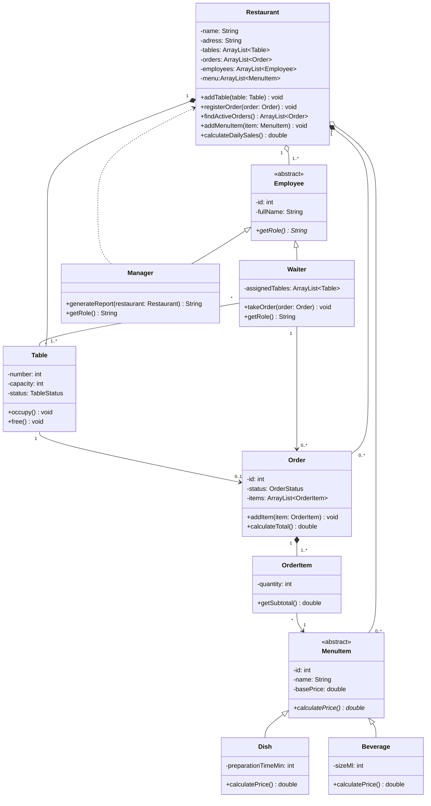

# POO_FinalProject_Gonzalez_Arias
# Restaurant Order Management

### Integrantes
- Esteban Gonzalez Garcia - Código: (69632)
- David Fernando Arias - Código: (70297)

### Descripción general del sistema
Sistema para el personal de un restaurante que permite registrar pedidos, calcular cuentas y gestionar mesas.

### Diagrama de clases UML

