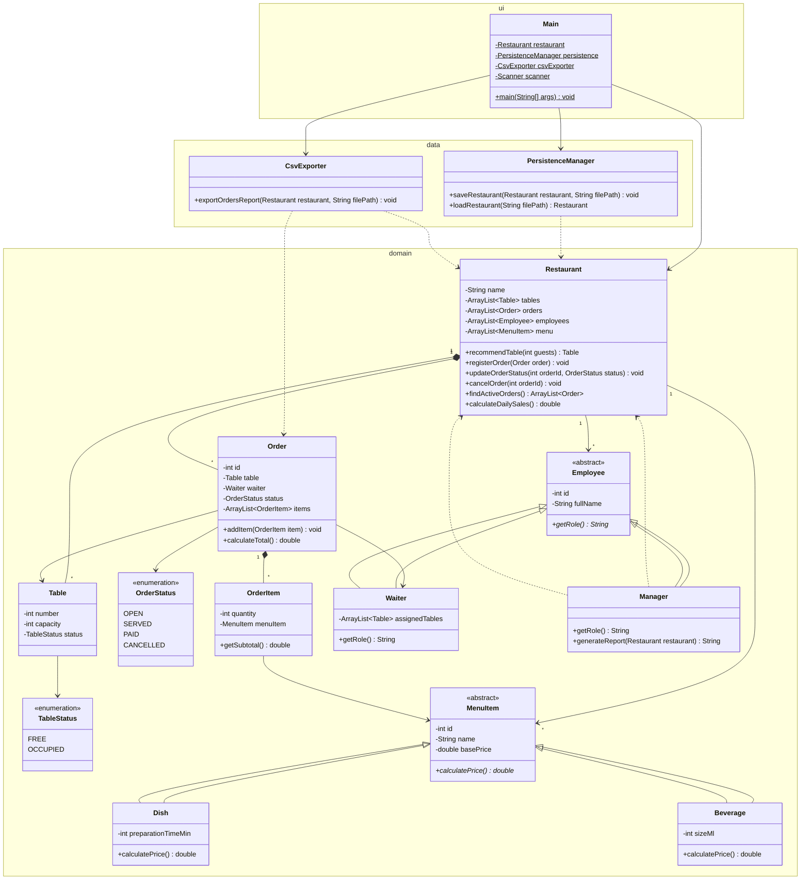

# POO_FinalProject_Gonzalez_Arias
# Restaurant Order Management

### Integrantes
- Esteban Gonzalez Garcia - Código: (69632)
- David Fernando Arias - Código: (70297)

### Descripción general del sistema
Sistema para el personal de un restaurante que permite registrar pedidos, calcular cuentas y gestionar mesas.

## Arquitectura del Proyecto (`src/`)
* **`domain/` (Lógica de Negocio):** Contiene las entidades centrales del modelo (`Restaurant`, `Table`, `Order`, `OrderItem`), enumeraciones (`TableStatus`, `OrderStatus`), clases base abstractas (`MenuItem`, `Employee`) y subclases con comportamiento polimórfico (`Dish`, `Beverage`, `Waiter`, `Manager`).
* **`data/` (Persistencia e Intercambio de Datos):** Implementa el guardado y carga del estado completo del sistema mediante serialización binaria (`PersistenceManager` usando `ObjectOutputStream` y `ObjectInputStream`) y la exportación de reportes tabulares (`CsvExporter`).
* **`ui/` (Interfaz de Usuario):** Contiene la clase `Main`, responsable de la interacción por consola, menús de opciones y manejo de excepciones.

## Guía de Opciones del Sistema (Menú Principal y Submenús)

Al iniciar la aplicación, el operador o administrador accede al menú principal con las siguientes opciones:

1. **Mesas (`1. Mesas`):** Administra la capacidad física y disponibilidad del salón.
   * *Agregar:* Registra una nueva mesa con su número identificador y capacidad de comensales (inicia en estado `FREE`).
   * *Listar:* Muestra todas las mesas registradas junto con su capacidad y estado actual (`FREE` u `OCCUPIED`).
   * *Actualizar:* Permite modificar la capacidad de una mesa existente.
   * *Eliminar:* Elimina una mesa del sistema (bloqueado si la mesa tiene pedidos activos).
   * *Recomendar:* Módulo de apoyo a decisiones; recibe la cantidad de comensales y sugiere automáticamente la mesa libre (`FREE`) con la menor capacidad suficiente para evitar desperdicio de espacio.
2. **Empleados (`2. Empleados`):** Gestiona el personal operativo y administrativo.
   * *Agregar:* Permite registrar un Mesero (`Waiter`) o un Gerente (`Manager`) con su ID y nombre completo.
   * *Listar:* Muestra el personal registrado indicando su rol polimórfico (`getRole()`).
   * *Actualizar:* Permite editar el nombre del empleado o las mesas asignadas a un mesero.
   * *Eliminar:* Da de baja a un empleado (restringido si tiene pedidos asociados en el historial).
3. **Menú (`3. Menu`):** Administra la oferta gastronómica del restaurante.
   * *Agregar:* Permite registrar un Plato (`Dish`, indicando tiempo de preparación en minutos) o una Bebida (`Beverage`, indicando volumen en mililitros).
   * *Listar:* Muestra todos los productos disponibles junto con su precio base y su precio final calculado polimórficamente (`calculatePrice()`).
   * *Actualizar:* Permite modificar el nombre o precio base de un producto.
   * *Eliminar:* Retira un producto del catálogo.
4. **Pedidos (`4. Pedidos`):** Controla el ciclo de vida completo de la atención en mesa.
   * *Crear Pedido:* Asocia una mesa disponible y un mesero atendiendo, crea el pedido en estado `OPEN` y cambia automáticamente la mesa a `OCCUPIED`.
   * *Agregar Ítems al Pedido:* Permite añadir platos o bebidas con su respectiva cantidad (`OrderItem`) a un pedido abierto.
   * *Listar Pedidos:* Consulta todos los pedidos o filtra únicamente los pedidos activos (`OPEN` / `SERVED`).
   * *Cambiar Estado:* Avanza el flujo del pedido (`OPEN` → `SERVED` → `PAID`). Al marcarlo como `PAID`, se registra la venta y la mesa vuelve a quedar `FREE`.
   * *Cancelar Pedido:* Anula un pedido activo cambiando su estado a `CANCELLED` y liberando la mesa sin eliminarlo del historial.
5. **Reportes y Exportación CSV (`5. Reportes/CSV`):** Genera información gerencial y archivos externos.
   * *Reporte Gerencial:* Ejecuta el método `generateReport()` del `Manager` mostrando un resumen en consola con el total de mesas, total de pedidos y ventas acumuladas del día.
   * *Exportar a CSV:* Genera el archivo `sales_report.csv` con encabezados y el detalle tabular de todos los pedidos registrados (ID, número de mesa, mesero, estado, cantidad de ítems y monto total).
6. **Guardar y Salir (`0. Guardar y Salir`):** Serializa todo el estado del objeto `Restaurant` en el archivo binario `restaurant_data.dat` para conservar la información en la próxima ejecución y cierra el programa.

## Operaciones CRUD, Reglas de Negocio y Restricciones
* **Mesas (`Table`):** Soporta CRUD completo. **Restricción:** No se permite eliminar ni ocupar una mesa que tenga un pedido activo (`OPEN` o `SERVED`).
* **Empleados (`Waiter`, `Manager`):** Soporta CRUD completo. **Restricción:** No se permite eliminar empleados asociados a pedidos activos o históricos para conservar la trazabilidad de quién atendió cada orden.
* **Productos del Menú (`Dish`, `Beverage`):** Soporta CRUD completo. **Polimorfismo:** `Dish` aplica un recargo del 8% por preparación en `calculatePrice()`, mientras que `Beverage` retorna su precio base.
* **Pedidos (`Order`):** Soporta creación, adición de ítems, cambio de estado y cancelación. **Restricción de registros históricos:** Los pedidos pagados (`PAID`) o cancelados (`CANCELLED`) no pueden modificarse ni eliminarse; ante un error en un pedido activo, se utiliza la anulación mediante `cancelOrder()` para mantener la trazabilidad y liberar automáticamente la mesa asignada.

### Diagrama de clases UML



## Ejemplo de Entrada / Salida

```text
Iniciando restaurante nuevo...

=== Mi Restaurante ===
1. Mesas  2. Empleados  3. Menu  4. Pedidos  5. Reportes/CSV  0. Guardar y Salir
Elija una opcion: 1

--- MESAS ---
1. Agregar  2. Listar  3. Actualizar  4. Eliminar  5. Recomendar
Opcion: 1
Numero: 1
Capacidad: 4
Mesa agregada.

=== Mi Restaurante ===
1. Mesas  2. Empleados  3. Menu  4. Pedidos  5. Reportes/CSV  0. Guardar y Salir
Elija una opcion: 2

--- EMPLEADOS ---
1. Agregar  2. Listar  3. Actualizar  4. Eliminar
Opcion: 1
Tipo (1. Mesero / 2. Gerente): 1
ID: 101
Nombre: Carlos Ruiz
Mesero agregado.

=== Mi Restaurante ===
1. Mesas  2. Empleados  3. Menu  4. Pedidos  5. Reportes/CSV  0. Guardar y Salir
Elija una opcion: 3

--- MENU ---
1. Agregar  2. Listar  3. Actualizar  4. Eliminar
Opcion: 1
Tipo (1. Plato / 2. Bebida): 1
ID: 10
Nombre: Pasta Carbonara
Precio base: 25000
Tiempo de preparacion (min): 15
Plato agregado (Precio final: $27000.0).

=== Mi Restaurante ===
1. Mesas  2. Empleados  3. Menu  4. Pedidos  5. Reportes/CSV  0. Guardar y Salir
Elija una opcion: 4

--- PEDIDOS ---
1. Crear Pedido  2. Agregar Item  3. Listar  4. Cambiar Estado  5. Cancelar
Opcion: 1
ID Pedido: 1001
Numero de mesa: 1
ID Mesero: 101
Pedido creado (Estado: OPEN). Mesa 1 ahora esta OCCUPIED.

--- PEDIDOS ---
1. Crear Pedido  2. Agregar Item  3. Listar  4. Cambiar Estado  5. Cancelar
Opcion: 2
ID Pedido: 1001
ID Producto: 10
Cantidad: 2
Item agregado (Subtotal: $54000.0).

--- PEDIDOS ---
1. Crear Pedido  2. Agregar Item  3. Listar  4. Cambiar Estado  5. Cancelar
Opcion: 4
ID Pedido: 1001
Nuevo estado (1. SERVED / 2. PAID): 2
Pedido actualizado a PAID. Total: $54000.0. Mesa 1 liberada (FREE).

=== Mi Restaurante ===
1. Mesas  2. Empleados  3. Menu  4. Pedidos  5. Reportes/CSV  0. Guardar y Salir
Elija una opcion: 5

--- REPORTES Y CSV ---
1. Reporte Gerencial  2. Exportar CSV
Opcion: 2
Reporte exportado a sales_report.csv

=== Mi Restaurante ===
1. Mesas  2. Empleados  3. Menu  4. Pedidos  5. Reportes/CSV  0. Guardar y Salir
Elija una opcion: 0
Datos guardados en restaurant_data.dat
Saliendo...
```
